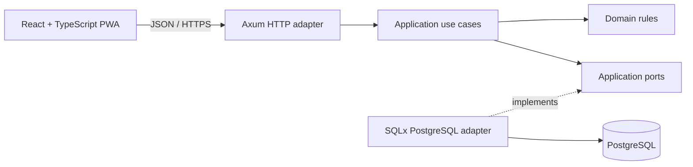

<div align="center">
  
  <h1>Caloryst</h1>
  <p><strong>Understand your intake. Own your daily habits.</strong></p>
  <p>An open-source calorie-tracking PWA built around a clear, practical food diary.</p>
  <p>
    <a href="LICENSE"></a>
    
    
    
    
    
  </p>
  <p>
    <a href="#overview">Overview</a> ·
    <a href="#architecture">Architecture</a> ·
    <a href="#roadmap">Roadmap</a> ·
    <a href="#development">Development</a> ·
    <a href="CONTRIBUTING.md">Contributing</a> ·
    <a href="https://github.com/Zvenytoh/Caloryst/issues">Issues</a>
  </p>
</div>

---

## Overview

Caloryst is an open-source calorie counter designed as a progressive web app
(PWA) with individual user accounts. Its first goal is a straightforward daily workflow:
choose a food, enter a portion, and understand the day's calorie intake.

The architecture keeps nutrition rules independent of the web framework and
database. A React interface communicates with a Rust API, while PostgreSQL
stores account mappings, food records, and private diary entries.

### Project status

**Early development.** The React PWA in `apps/web` runs against an in-memory
development API. There is no Rust API, database schema, or release yet.

## Planned first release

- **Installable PWA** — a responsive app for mobile and desktop, with standalone launch on supported browsers.
- **Individual accounts** — sign in and access your own food records and diary.
- **Food records** — create foods with an explicit energy value per 100 g.
- **Daily diary** — record gram-based portions against an intended calendar date.
- **Daily overview** — view entries and server-calculated calorie totals.
- **Reliable history** — preserve the nutrition values used when an entry was logged.
- **Accessible web interface** — clear forms, keyboard navigation, and explicit loading and error states.

External food catalogs, barcode scanning, recipes, macro tracking, native mobile
apps, and offline synchronization are outside the proposed first milestone.

The proposed initial offline experience covers the public app shell and a clear
connection-required screen. Private diary access and saving entries require a
connection; offline logging and synchronization remain separate scope decisions.

## Architecture

**Clean Architecture, delivered as a modular monolith.** One API and one database
keep deployment straightforward. Business rules live behind explicit boundaries.



The diagram combines request flow with adapter relationships; source dependencies
always point toward the application and domain. The domain imports neither Axum
nor SQLx. HTTP handlers translate requests; use cases own workflows; database
adapters implement application-owned persistence contracts.

Read the [architecture specification](docs/ARCHITECTURE.md) for dependency rules,
the proposed source layout, account isolation, and a complete request flow.

## Technology direction

| Layer | Proposed technology | Responsibility |
| :--- | :--- | :--- |
| Web interface | React + TypeScript + Vite, delivered as a PWA | Installable interface, forms, navigation, API integration |
| HTTP API | Rust + Axum + Tokio | Transport, verified identity, request lifecycle |
| Business logic | Rust domain and application crates | Nutrition rules, use cases, ownership policy |
| Persistence | PostgreSQL + SQLx | Parameterized queries, transactions, migrations |

This is the recommended implementation direction. Exact versions and the identity
provider will be selected before scaffolding. The
[engineering standards](docs/ENGINEERING.md) describe the intended development practices.

## Roadmap

- [x] Repository, license, logo, and contributor documentation.
- [x] Initial Clean Architecture specification and engineering standards.
- [ ] Confirm identity provider, hosting constraints, and retention policy.
- [x] Scaffold the React + TypeScript application.
- [x] Add the PWA manifest, install icons, public-shell caching, and update flow.
- [x] Build the food-to-diary interface, daily summary, and entry editing/deletion (against the development API).
- [ ] Scaffold the Rust workspace and deliver the real API and PostgreSQL schema.
- [ ] Import the CIQUAL and Open Food Facts catalogs with source attribution.
- [ ] Complete release checks, deployment instructions, and data lifecycle controls.

## Development

```sh
git clone https://github.com/Zvenytoh/Caloryst.git
cd Caloryst
```

The web app needs Node.js 20.19+ (or 22.12+) and npm:

```sh
cd apps/web
npm install
npm run dev        # http://localhost:5173 with the in-memory development API
npm run typecheck  # strict TypeScript
npm run lint       # oxlint, including React Hooks rules
npm run build      # production bundle and service worker in dist/
npm run preview    # serve the production build with the development API
```

`apps/web/dev/mock-api.ts` implements the planned `/api/v1` contract in memory for
development and preview only; data is lost on restart and "Se connecter" signs in
a demo account without a password. The service worker is registered only in
production builds. No Rust checks or CI workflows exist yet.

The web app uses the working name **Kalo** (logo masters and icons in
`branding/kalo/`). Beyond the first milestone, the development API also covers
macronutrients per food, meals, daily goals, water, and manual activities; the
Rust API must implement the same contract before it replaces the mock.

| Document | Read it for |
| :--- | :--- |
| [Architecture](docs/ARCHITECTURE.md) | Layers, dependencies, data boundaries, deployment direction |
| [Engineering standards](docs/ENGINEERING.md) | Rust, Axum, React, TypeScript, persistence conventions |
| [Contributing](CONTRIBUTING.md) | Contribution scope and validation expectations |
| [Tooling](docs/TOOLING.md) | RTK, skills, Context7, Graphify, and analysis tools |
| [Agent instructions](AGENTS.md) | Repository rules for coding agents |
| [Branding](docs/BRANDING.md) | Logo concept, asset, and generation provenance |

## Contributing and support

Focused contributions and architecture feedback are welcome. Open an
[issue](https://github.com/Zvenytoh/Caloryst/issues) with the problem, expected
behavior, and relevant context. Read [CONTRIBUTING.md](CONTRIBUTING.md) before
starting a substantial change. Never include credentials or personal food records.

## License

Caloryst is released under the [MIT License](LICENSE), including the project logo.
