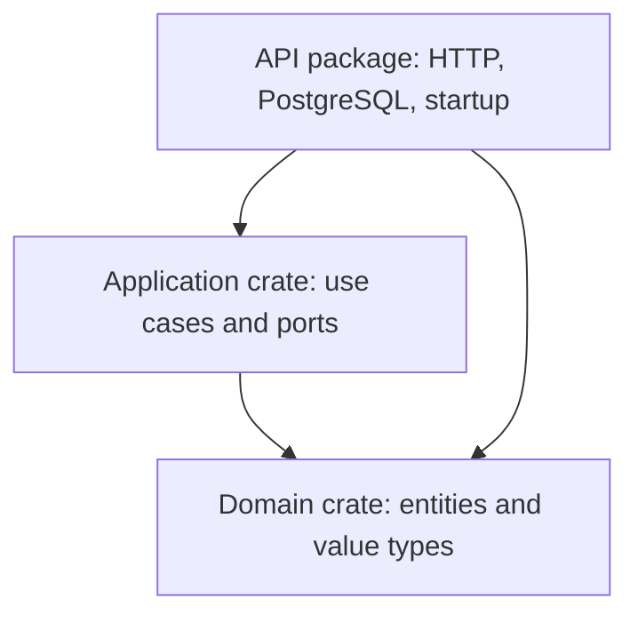

# Caloryst architecture

**Status:** proposed design, not an implemented system.

**Product constraint:** a progressive web app (PWA) with individual user accounts.

**Technical recommendation:** React + TypeScript, Rust + Axum, PostgreSQL + SQLx.

The PWA target, account model, and Clean Architecture direction come from the project owner.
The layout, authentication integration, and data representation below are engineering
recommendations for review before implementation.

## 1. Scope

Build one complete workflow first: a signed-in user creates a food, records a
gram-based portion in their diary, and reads the day's entries and total.
Manual food entry avoids choosing an external catalog before reviewing its
license, quality, and availability.

Start with one backend process and one PostgreSQL database. Use compile-time
boundaries rather than distributed services. An event bus, generic CRUD framework,
and repository for every table are unnecessary at this stage.

## 2. Dependency rule

Business policy must not depend on delivery or storage details, following the
[Clean Architecture dependency rule][clean].



These arrows represent **source dependencies**, not database call direction.
At runtime a use case calls an application-owned trait implemented by a PostgreSQL
adapter. Startup constructs and injects the concrete adapters.

| Boundary | Owns | Dependencies | Must not leak inward |
| :--- | :--- | :--- | :--- |
| Domain | Foods, diary snapshots, quantities, energy, invariants | Standard library and justified value libraries | HTTP, SQL rows, framework state |
| Application | Commands, use cases, ports, ownership policy, errors | Domain | Axum, SQLx, transactions, HTTP status codes |
| HTTP adapter | Routes, DTOs, session extraction, response mapping | Application and domain | Wire formats and extractor types |
| PostgreSQL adapter | Queries, row mapping, transactions, storage errors | Application, domain, SQLx | Driver types and errors |
| Composition root | Config, pool, services, router, shutdown | All backend layers | Service locator or global mutable configuration |

Use distinct DTOs, entities, and row types where their semantics differ. Keep
transport serialization out of core entities; avoid mechanical mapping layers
that do not protect a real boundary.

## 3. Proposed source layout

Target layout only: these source directories do not exist yet.

```text
Caloryst/
├── Cargo.toml                       workspace manifest
├── crates/
│   ├── caloryst-domain/src/          food, diary, nutrition, errors
│   └── caloryst-application/src/     use cases, commands, ports, errors
├── apps/
│   ├── api/
│   │   ├── src/
│   │   │   ├── main.rs              entry point and dependency wiring
│   │   │   ├── config.rs            validated startup configuration
│   │   │   ├── http/                routes, DTOs, sessions, response errors
│   │   │   ├── identity/            OIDC integration and identity mapping
│   │   │   └── postgres/            SQLx adapters and row mapping
│   │   └── migrations/              versioned SQL migrations
│   └── web/
│       ├── public/                  manifest and install icons
│       └── src/
│           ├── app/                 bootstrap, routing, providers
│           │   └── pwa/             worker registration and update UI
│           ├── features/
│           │   ├── auth/            session UI and sign-in flow
│           │   ├── foods/           components, model, hooks, API access
│           │   └── diary/           components, model, hooks, API access
│           └── shared/              reused UI, transport, generated contracts
├── assets/
└── docs/
```

Use three backend packages: domain, application, API. The outer API package owns
HTTP, identity, and PostgreSQL modules. Separate adapter crates can wait until a
real reuse need arises. Domain/application exclude Axum, SQLx, Tokio, and wire
serialization dependencies. Limit visibility rather than exporting every module.

## 4. Domain and nutrition

Domain logic is synchronous and deterministic: no storage, request context, clock
access, or background tasks.

| Concept | Proposed invariant |
| :--- | :--- |
| Food | Private to its owner initially; name and kcal per 100 g required |
| Portion | Positive grams, up to three fractional digits |
| Energy density | Nonnegative kcal per 100 g, up to three fractional digits |
| Diary entry | Owner, diary date, grams, food name and density snapshot |
| Daily summary | One owner's entries for one date; server-derived total |

Use private fields and fallible constructors for validated value types. Choose
explicit product upper bounds with the first schema; validate before arithmetic.

Recommended representation: decimal arithmetic in Rust, `NUMERIC(12,3)` for
stored grams and density, decimal strings in JSON. Reject excess input precision
rather than silently rounding. Database checks also reject NaN and out-of-range
values; use `NOT NULL` alongside range checks. Validate rows on entry to the domain.

At 80 kcal/100 g, a 150 g portion yields 120 kcal. Keep a name/density snapshot
on the entry, so changing a food does not rewrite history. Calculate totals from
unrounded values, then round for display to one decimal place using a documented
midpoint-away-from-zero policy. Do not store a second independently editable total.

A diary date is an explicit `YYYY-MM-DD` calendar date selected by the user, not
a UTC timestamp truncated to midnight. Store audit instants as `timestamptz`.
The browser may suggest today's local date; it sends the intended date explicitly.

## 5. Use cases, ports, and transactions

Examples: `CreateFood`, `RecordFood`, `GetDailyDiary`. Use ordinary functions or
small structs with explicit dependencies; commands/results use core types.

Define narrow ports such as `FoodRepository` and `DiaryRepository` in the application
crate. Use domain-specific operations, not a generic CRUD base trait. Port errors
distinguish missing records, conflicts, and unavailable dependencies without SQLx.

Prefer generics and static dispatch initially. Async ports must express the `Send`
future guarantees required by Axum; native async trait methods are not automatically
usable through `dyn Trait`. Add boxing or async-trait only if dynamic dispatch is needed.

One atomic write is one port operation. Its adapter owns the transaction and
rolls back on failure; no `sqlx::Transaction` crosses into the application. When a
workflow needs multiple writes, define a suitably atomic operation before adding
a general unit-of-work framework.

## 6. Example: record a food

1. The browser sends food ID, grams as a decimal string, and diary date.
2. Axum validates the request shape and obtains an actor from a verified session.
3. `RecordFood` receives actor and command, validating quantity and date.
4. The food port loads a name/density snapshot **scoped to the actor**. Missing
   and inaccessible food IDs produce the same not-found result.
5. Domain logic validates the snapshot and calculates energy. The application
   passes owner, date, grams, and snapshot to the diary write port.
6. PostgreSQL inserts the entry atomically. A concurrent catalog edit cannot alter
   the snapshot already read. Catalog deletion must not remove diary history.
7. The HTTP adapter maps the result to a response DTO with `201 Created`.
8. The frontend refreshes that day's data and displays the server result.

Read, edit, and delete queries also scope access to the actor. An entry ID or
browser-supplied owner ID does not confer authorization.

## 7. Accounts and security

Recommend an established OpenID Connect provider, avoiding password storage in
the first milestone. Provider choice and login methods remain open. Use a maintained
OIDC client: authorization-code flow, PKCE, state/nonce, issuer/audience validation,
and allowlisted callback redirects. Identity integration stays in outer adapters.

Map verified `(issuer, subject)` to a local user ID with a unique constraint.
Emails are profile attributes, not identity keys. After authentication, issue a
server-managed opaque session and store its token hash in PostgreSQL. Use
`Secure`, `HttpOnly`, `SameSite=Lax` cookies in production. Keep tokens out of
localStorage; rotate sessions on login, revoke on logout, and enforce expiry.

The HTTP layer produces a verified application actor. Every private use case
requires it; private repository operations require its user ID. Never trust a
request's `user_id` as owner. Use owner-scoped SQL and relational constraints
to prevent cross-user references. Frontend route guards do not enforce access.

Protect state-changing cookie-authenticated requests with CSRF tokens and origin
validation. SameSite is additional protection; GET must not mutate data. Prefer
a single public origin for web and API rather than permissive CORS.

Account deletion must revoke sessions and follow an explicit data policy. Session
durations, account creation, provider-side deletion, and backup retention must be
settled before release. Follow [OIDC][oidc], [session guidance][sessions], and
[CSRF guidance][csrf] when implementing these recommendations.

## 8. HTTP contract

Proposed endpoints; none are implemented:

| Method | Path | Responsibility |
| :--- | :--- | :--- |
| GET | `/api/v1/session` | Safe session status |
| GET / POST | `/api/v1/foods` | List/create the actor's foods |
| GET | `/api/v1/diary?date=YYYY-MM-DD` | Actor's entries and daily total |
| POST | `/api/v1/diary/entries` | Save a portion and nutrition snapshot |
| PATCH / DELETE | `/api/v1/diary/entries/{id}` | Edit/delete an owned entry |

Specify authentication routes when choosing the provider. Bound body size, names,
pagination, and list sizes. DTO validation complements domain invariants.

Use one error envelope: code, safe message, optional field errors, request ID.
Map malformed input to 400, domain validation to 422, unauthenticated requests to
401, missing/inaccessible resources to 404, conflicts to 409, unexpected failures
to a generic 500. Normalize extractor rejections; never return raw SQL errors.

Define OpenAPI with the first handlers and generate TypeScript wire types from
it. Parse network JSON at runtime: generated types do not validate external data.
Commit the contract and generated types, checking drift once tooling exists.

## 9. React boundaries

Organize by feature, without copying every backend layer into the UI. Each feature
owns components, hooks, model, and API adapter. Components render typed state and
trigger actions; adapters fetch, validate, and map wire data. Plain model functions
handle reusable presentation logic.

Features expose a small public surface; do not import another feature's internals.
`shared/` holds genuinely reused code, and `app/` composes routes/providers.

Keep form strings and selection state local. The server owns saved entries and
nutrition totals; do not duplicate business calculations in TypeScript. Handle
loading, empty, unauthenticated, error, and success states. Cancel obsolete requests
and prevent stale responses replacing the selected day's data. Begin with pessimistic
mutations; introduce caching or optimistic updates for a demonstrated need.

## 10. PWA delivery and lifecycle

The PWA belongs to the outer web delivery layer; installation, caching, and worker
lifecycle do not change domain or application dependencies. Exact build tooling
will be chosen during scaffolding.

Provide a web app manifest with stable identity, name, start URL, scope, standalone
display, theme colors, and suitable install icons, including 192/512 px and a
dedicated maskable variant. The current README logo is not yet an install-icon set.
Serve production over HTTPS and retain normal website behavior when installation
is unsupported. Install UI and instructions must reflect actual browser capabilities.

Recommended first milestone: cache only the public, non-personalized app shell
and build-versioned static assets. After an initial online load, offline launch
shows an explicit connection-required state. Private diary reads and writes
remain online; do not add IndexedDB diary storage, queued mutations, or background
sync without a separate conflict-resolution and privacy design.

| Resource | Initial policy |
| :--- | :--- |
| Public shell and hashed assets | Explicit precache allowlist, scoped to the build |
| API, session, authentication/callback routes | Network only; never store in Cache Storage |
| Private HTTP responses | `Cache-Control: no-store` at API/proxy; no persistent client cache |
| Navigation on network failure | Public shell fallback only for known frontend routes |

Never turn API errors or authentication redirects into cached HTML. The service
worker must explicitly exclude private routes; HTTP cache headers alone do not
define its Cache Storage policy. Clear private in-memory views on logout/account
switch, notify other tabs, and revalidate sessions on resume before showing data.
Logging out on the server requires a connection; do not claim revocation when offline.

Use versioned Caloryst-owned caches. Offer a visible update action when a worker
is waiting; do not force activation or reload while an entry form is unsaved.
Preserve old assets for active clients and delete only obsolete caches owned by
Caloryst once safe. Keep the worker URL stable and revalidatable. Deployment must
retain compatible API behavior and asset availability during client version overlap.

Offline logging, notifications, and a browser/device support matrix remain decisions
for later scope review. Installability and lifecycle guidance: [PWA installation][pwa]
and [service workers][workers].

## 11. Deployment

Serve frontend assets and `/api` behind one TLS origin; keep PostgreSQL private.
Validate configuration at startup. Secrets never enter source control or the
public Vite bundle. Use a bounded pool, request timeouts, graceful shutdown, and
structured request IDs. Do not log diary contents, full bodies, credentials, or tokens.

Rate-limit authentication and writes before public exposure. Separate liveness
from readiness. Never hold a database transaction while calling the identity provider.
Run versioned migrations as a controlled deployment step with a separate role;
the runtime database role must not have schema-change privileges.

Document backups, restore verification, retention, and safe migration rollout
before launch. Public readiness must not expose internal configuration.

## 12. Verification and open decisions

Plan verification at each boundary: arithmetic/rounding, fake-port use cases,
actual PostgreSQL constraints/transactions, HTTP validation and cross-user access,
and frontend interactions. Include fractional portions, history snapshots, date
boundaries, and one account attempting to modify another account's data.

PWA release verification must cover install/standalone launch, deep links, offline
shell fallback, private-route cache exclusion, logout/account switching across tabs,
and updates with an unsaved form. Check agreed mobile and desktop browsers on
real target environments; no such behavior has been implemented or validated yet.

No application checks are implemented here. Unit/functional tests run only on
explicit request. See [engineering standards](ENGINEERING.md) for intended checks.

Before implementation, confirm the proposed layout/manual-entry scope, choose
the identity provider and hosting, set operational/input bounds and retention,
and pin toolchains plus contract-generation tooling. Agree on the PWA browser/device
support matrix and initial offline scope before implementing the worker.

## References

These sources inform Caloryst's recommendations; they do not prescribe this layout.

- [Clean Architecture][clean]
- [Rust fallible APIs and validated types][rust]
- [Axum error handling][axum] and [graceful shutdown][shutdown]
- [SQLx query checking and offline mode][sqlx]
- [PostgreSQL numeric types][numeric] and [constraints][constraints]
- [React state and effects][react]
- [TypeScript strict checking][typescript]
- [OpenID Connect][oidc], [OWASP sessions][sessions], [OWASP CSRF][csrf]
- [PWA installation][pwa] and [service worker lifecycle][workers]

[clean]: https://blog.cleancoder.com/uncle-bob/2012/08/13/the-clean-architecture.html
[rust]: https://doc.rust-lang.org/book/ch09-03-to-panic-or-not-to-panic.html
[axum]: https://docs.rs/axum/latest/axum/error_handling/index.html
[shutdown]: https://github.com/tokio-rs/axum/tree/main/examples/graceful-shutdown
[sqlx]: https://docs.rs/sqlx/latest/sqlx/macro.query.html
[numeric]: https://www.postgresql.org/docs/18/datatype-numeric.html
[constraints]: https://www.postgresql.org/docs/18/ddl-constraints.html
[react]: https://react.dev/learn/you-might-not-need-an-effect
[typescript]: https://www.typescriptlang.org/tsconfig/strict.html
[oidc]: https://openid.net/specs/openid-connect-core-1_0.html
[sessions]: https://cheatsheetseries.owasp.org/cheatsheets/Session_Management_Cheat_Sheet.html
[csrf]: https://cheatsheetseries.owasp.org/cheatsheets/Cross-Site_Request_Forgery_Prevention_Cheat_Sheet.html
[pwa]: https://developer.mozilla.org/en-US/docs/Web/Progressive_web_apps/Guides/Making_PWAs_installable
[workers]: https://developer.mozilla.org/en-US/docs/Web/API/Service_Worker_API/Using_Service_Workers
